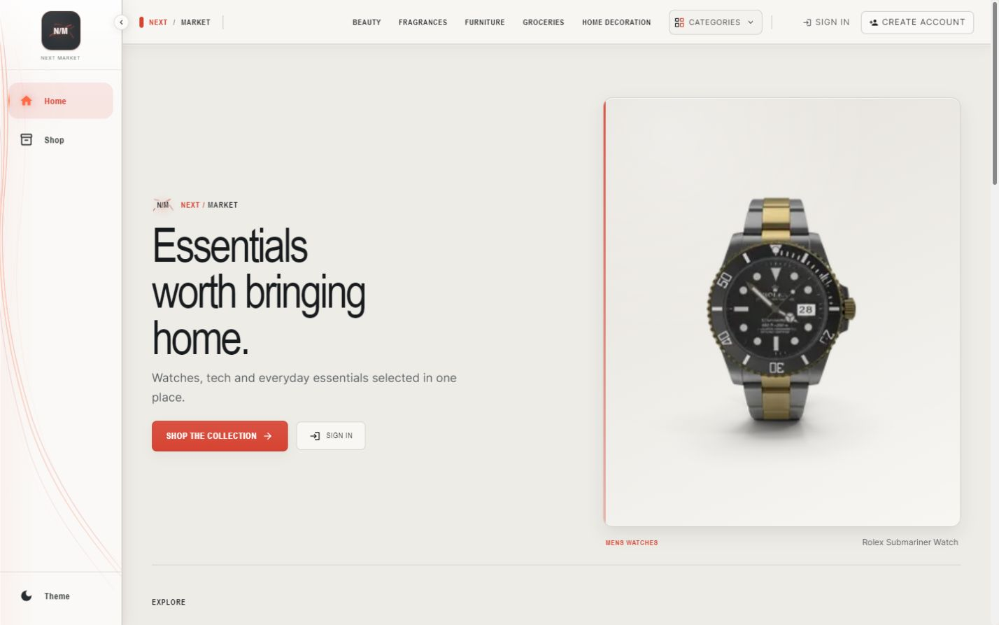
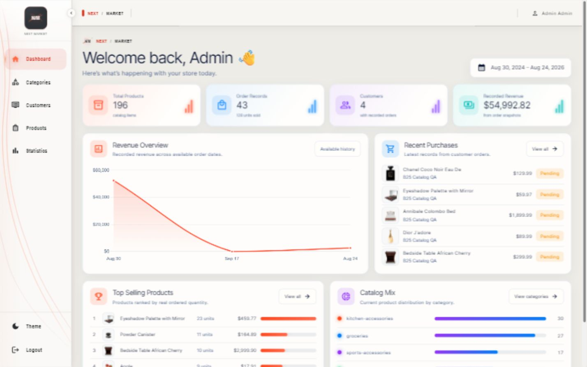
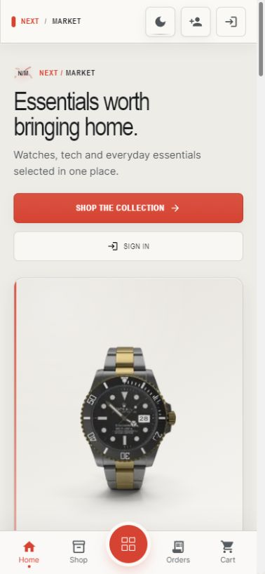

# NEXT / MARKET

**A production-deployed full-stack commerce platform with a responsive customer storefront and a dedicated Admin workspace.**

[Live Demo](https://next-market-store.vercel.app) · [Production API](https://next-market-api.vercel.app)



## Product overview

NEXT / MARKET brings the customer and operational sides of commerce into one coherent product. Customers can browse the catalog, manage a cart, complete checkout, review orders, and maintain their account. Administrators get focused tools for products, categories, customers, order activity, and store performance.

## Key features

- Responsive storefront with category discovery, filtering, favorites, cart, checkout, order history, and account management
- Role-separated Admin workspace with dashboard metrics, catalog management, customer order views, and statistics
- Consistent Light and Dark themes across desktop and mobile layouts
- JWT authentication with server-side authorization and refresh restoration
- Atomic, idempotent checkout with transactional inventory updates and oversell protection
- Ownership-protected customer data, sanitized API responses, validation, rate limiting, and security headers

## Product views

| Admin workspace | Mobile storefront |
| --- | --- |
|  |  |

## Architecture

| Layer | Technology |
| --- | --- |
| Frontend | React 18, Vite, React Router, Redux Toolkit, Material UI, Framer Motion, Chart.js |
| API | Node.js 26, Express, Mongoose, JWT, bcrypt |
| Data | MongoDB Atlas replica set |
| Hosting | Separate Vercel frontend and Node.js API projects |

```text
client/   React storefront and Admin interface
server/   Express API, MongoDB models, services, and tests
```

The frontend and API deploy independently. Browser configuration, server secrets, scaling, and CORS boundaries remain explicit while both projects share one source repository.

## Security and reliability

- Protected and Admin endpoints enforce authorization on the server
- Customer-owned resources are scoped from the verified JWT identity
- Checkout uses MongoDB transactions, atomic stock predicates, idempotency constraints, and rollback handling
- Passwords are hashed; sensitive fields are excluded from public responses
- Production CORS is restricted to the deployed storefront origin
- Environment values stay outside source control through Vercel environment configuration

## Verification

The automated suites cover authentication, authorization, data ownership, checkout rollback, concurrent stock protection, idempotency, routing, responsive composition, and Admin data presentation. Production verification also covers direct navigation, refresh restoration, role separation, Light/Dark themes, API communication, and browser/runtime health.

```bash
cd server
npm test

cd ../client
node --test
npm run build
```

## Local development

Requirements: Node.js 26 LTS, npm, and a MongoDB deployment with transaction support.

```bash
cd server
npm install
npm start
```

```bash
cd client
npm install
npm run dev
```

Create local `.env` files from the included `.env.example` templates. Required names:

- Client: `VITE_ORIGIN`
- Server: `ORIGIN`, `MONGOOSE_URI`, `SECRET_KEY`

Never commit populated environment files or credentials.

## Deployment

- Storefront: [next-market-store.vercel.app](https://next-market-store.vercel.app)
- API: [next-market-api.vercel.app](https://next-market-api.vercel.app)
- Runtime: Node.js 26 LTS
- Database: MongoDB Atlas

## Documentation

- [Frontend setup](client/README.md)
- [API setup and maintenance](server/README.md)

## License

All rights reserved. No public license has been granted.
